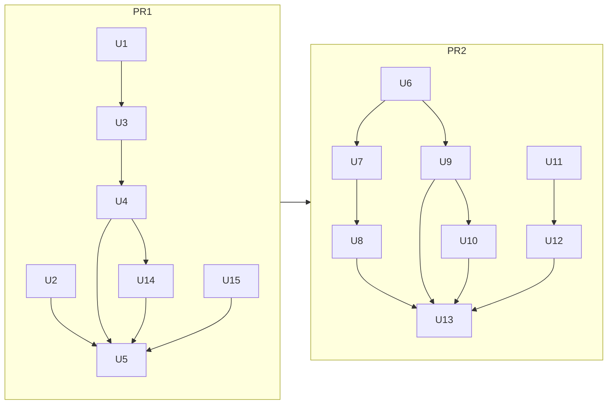

# Spring cleaning before the form tests - Plan

## Goal Capsule

- **Objective.** The next TT test (5.F, 5.G) is written as its spec rows,
  its evidence and little else, and every doc describes what is on `main`.
  Every outcome the tool gives today stays the same.
- **Means.** Fix the real gaps the 2026-11-01 audit found, then move the
  mechanics the seven checks repeat into shared helpers (KTD5).
- **Authority.** CLAUDE.md principles, then the rules specs in
  `docs/rules/`, then this plan. A spec row always wins over a helper.
- **Execution profile.** Two PRs (KTD2): PR1 is small fixes, docs and dead
  code; PR2 is shared helpers and test setup. One commit per unit.
- **Stop conditions.** Stop and show Abby, without changing an expected
  result, when any of these happen:
  - a fixture, ACT or Baseline outcome changes (R10);
  - the judge eval shows a false PASS or a new mismatch (R11);
  - a realistic budget page goes over 120 s (R12);
  - one fix attempt at a failing test does not work (Abby's global rule).
- **Who finishes.** `ce-work` builds PR1 on `spring-cleaning` and PR2 on a
  branch cut from PR1's head (KTD2); Abby reviews and merges.

---

## Product Contract

### Summary

Two PRs. The first fixes a principle 2 gap, a setting that fails late, a
4.E dialog-detection risk, out-of-date docs and dead code. The second gives
the checks shared helpers for findings, plain-language text, questions,
screenshots, replays and JavaScript snippets, shares test and eval setup,
and points base.py's "add a check" steps at the helpers.

### Problem Frame

Each check after 4.C was built by copying the one before it, so about 600
lines of finding scaffolding, plain-language helpers, question building and
JavaScript are repeated across `src/a11y_assist/checks/`. The copies have
drifted:

- when focus cannot move anywhere, four checks (4.C, 4.D, 4.E, 4.F) omit
  the "could not be performed" note that the other three set;
- labels are cut at 50 characters in one check and 60 in the others;
- the run time limit sentence is written eight ways.

base.py tells the next author to copy `t4e.py`, so 5.F and 5.G would
inherit all of it.

The audit also found docs behind `main`: the README leaves out 5.D, the
CLAUDE.md Layout misses three modules, and the build-task files cite old
spec versions. Abby is about to add the form tests and start the agent
eval, so this is the cheap moment to clean up.

### Requirements

**Fixes**

- R1. When focus cannot move anywhere (row A2), every check's finding
  carries "This test could not be performed", as principle 2 requires.
- R2. A judge backend that is not built is refused before any page work
  starts.
- R3. 4.E builds dialog keys with `traverse.PATH_JS`, so two different
  dialogs never share a key and the second is still detected.

**Docs and dead code**

- R5. README, CLAUDE.md, the build-task files, ROADMAP and `pyproject.toml`
  describe what is on `main`.
- R6. Names that nothing uses are removed.

**Fixtures**

- R14. No custom fixture's visible text describes the case it tests, so a
  judge agent reading the page learns only what a real page would show. The
  4.C injection page (f32) keeps its note on purpose, and the judge eval
  shows the agent is not swayed by it.

**Shared mechanics**

- R7. The repeated mechanics in the checks live in one shared place:
  findings, plain text, questions and answers, screenshots, replay to a
  stop. A check keeps only its spec rows, its evidence and what is truly its
  own.
- R8. JavaScript snippets the checks repeat (the visibility check and the
  composite selector) are defined once.
- R9. Test and eval setup that is copied (harness, fixture listing, ACT
  tests, settings, resolver, static servers) is defined once, so the eval
  scripts run with the same settings as the tests.
- R13. base.py's "add a check" steps point the next author at the shared
  helpers instead of telling them to copy a check.

**Invariants**

- R10. Every fixture, ACT case and Baseline case keeps its outcome, and the
  DHS/ACT agreement scores printed after the suite stay the same.
- R11. The local judge eval shows no false PASS and no new mismatch after
  any question's text changes.
- R12. Both realistic budget pages still finish every implemented test
  within one 120 s call.

### Key Decisions

- **Outcomes identical, wording may change.** Governs R7, R10, R11.
  (session-settled: user-directed, chosen over byte-identical output: the
  helpers should even out summaries and notes; the local judge eval is
  rerun whenever question text changes.)
- **pipeline.py and traverse.py stay untouched.** Governs R7, R8.
  (session-settled: user-directed, chosen over refactoring them now: they
  are the stable baseline that shows whether anything else broke, and
  refactoring them saves little for the next test.)
- **Page rows G1-G5 stay per spec.** Governs R5, R7. (session-settled:
  user-approved, chosen over merging them into `engine.py`: their G4 rows
  really differ, and merging would move outcome logic out of the specs.
  CLAUDE.md's wording is fixed instead.)

### Scope Boundaries

Not built (considered):

- Refactoring `pipeline.py` (the 155-line `run_tt_tests`, `_LazyBrowser`,
  the double `collect_versions`) and `traverse.py` (its two path builders,
  the long `FocusReader._read`, the 4.C-only `bypass`). Kept as the stable
  baseline. Revisit after the form tests if they still slow work down.
- The `a11y_` prefix on prompts and resources. CLAUDE.md's rule covers
  tools only, and the names are unique already.
- Moving the 4.C-only answer types (`J1Answer`, `J2Answer`) out of
  `models.py`. They are part of the report schema, and moving them buys
  nothing for 5.F.
- `inject_andi` being unused in production. It belongs to the ANDI spike
  on the roadmap.
- Aligning run-ID checks. The audit flagged it, but `answer_questions.py`,
  `resources/runs.py` and `prompts/explain.py` already share the same
  pattern and 64-character cap.

#### Deferred to Follow-Up Work

- Switching 4.F's `ORDER_FN` path builder (`gpath`) to `traverse.PATH_JS`.
  Its paths are used as selectors, so the switch could change 4.F order
  signals on pages the fixtures do not cover. That is a behavior change,
  not a move of shared code, so it needs its own fixture first.

- `ce-compound-refresh` on `docs/solutions/`. The audit found every symbol
  those files name still exists, so it can wait. Run it after PR2 if a
  helper move makes a lesson out of date.

---

## Planning Contract

### Key Technical Decisions

- KTD1. **Proof of identical outcomes is the existing suite plus the
  scores.** Fixture tests assert every expected outcome, and
  `tests/scoring.py` prints the DHS/ACT agreement after every run. Record
  the scores at the start of PR1, and compare them after every unit. The
  suite does not check the note on most findings, so U1 adds one harness
  check: a finding carries `TEST_NOT_PERFORMED_NOTE` exactly when its
  outcome is NEEDS_REVIEW (as `docs/rules/_template.md` row G3 and the A2
  rows require). That makes every fixture guard the note while U6 moves
  its code.
- KTD2. **Two PRs, PR2 branched from PR1.** (session-settled: user-approved,
  chosen over one combined PR: the fixes are quick to review and merge on
  their own, and the refactor gets a clean diff.)
- KTD3. **Checks may import from traverse; they never edit it.** Where a
  snippet already exists in traverse (`PATH_JS`), checks reuse it. Where
  traverse holds a private copy (the composite selector in
  `_DESCRIBE_FN`), the shared check module defines its own, and traverse
  keeps its copy until the deferred traverse work.
- KTD4. **The A2 note is a PATCH change to 4.C, 4.D, 4.E and 4.F.** It
  changes a note, not an outcome, and `docs/rules/_template.md` treats
  wording as a PATCH change. The new versions are 4.C 1.8.1, 4.D 1.1.1,
  4.E 1.1.1 and 4.F 1.1.3.
  `docs/hackathon/evaluation.md` and `deck.md` list no per-test versions
  (only a [FILL] placeholder), so they need no edit. Say so in the commit.
- KTD5. **New `src/a11y_assist/checks/common.py` for shared check
  mechanics, plus `src/a11y_assist/checks/js.py` for snippets.** Not
  `engine.py`, which stays the home of row tables and first-match.
  `RunContext` gains `shot` (screenshots) and `replay_to` (replay to a
  stop), because every check already receives it.
- KTD6. **Share only what means the same thing.** A difference that is a
  constant (a length limit, an empty-list default) becomes a parameter. A
  difference in meaning stays separate: t4c's `_norm` keeps case, and
  t4d's and t5d's name readers read different things. A check's own spec
  constants (`MAX_REPLAYS`, `WIDGET_MAX` and the like) stay in the check.
  So do the conditions that put an entry on a check's incomplete list: they
  feed the page rows (an entry gives G3 NEEDS_REVIEW, and none lets G4
  PASS), so sharing them would move outcome logic out of the specs. Only
  the sentence wording is shared.
- KTD7. **The judge backend setting accepts only built backends.**
  `Settings.judge_backend` becomes a closed choice of `client` in
  `src/a11y_assist/config.py`, so a bad value fails when settings load,
  before any run. `ApiJudge` stays as the planned slot.
- KTD8. **`compare_to` is the one name for verifying a fix.** README and
  ROADMAP already use it; CLAUDE.md says `verify_fix`. Change CLAUDE.md.
- KTD9. **`tests/drafts.py` stays.** The audit called it empty, but base.py
  step 4 and `evals/judge_eval.py` both use it for the next draft check. Only
  its CLAUDE.md line changes, to "empty between drafts".

### Sequencing

---

## Implementation Units

### PR1: Fixes, docs and dead code

Waits on: nothing.

### U1. The "could not be performed" note on A2 everywhere

**Goal.** 4.C, 4.D, 4.E and 4.F set the note on A2 the way 4.A, 4.B and
5.D already do, using `models.TEST_NOT_PERFORMED_NOTE` instead of the
literal. The harness then guards the note on every run.

**Requirements.** R1, R10. KTD1, KTD4.

**Dependencies.** None.

**Files.**
- `src/a11y_assist/checks/t4c.py` (the G1 branch in `evaluate`)
- `src/a11y_assist/checks/t4d.py`, `t4e.py`, `t4f.py` (the early returns)
- `src/a11y_assist/checks/t4a.py`, `t4b.py`, `t5d.py` (literal to
  constant)
- `docs/rules/4c-no-keyboard-trap.md`, `docs/rules/4d-focus-visible.md`,
  `docs/rules/4e-on-focus.md`, `docs/rules/4f-focus-order-meaning.md`
- `tests/harness.py`
- `tests/test_fixtures_4c.py`, `tests/test_fixtures_4d.py`,
  `tests/test_fixtures_4e.py`, `tests/test_fixtures_4f.py`

**Approach.**
1. In 4.D's, 4.E's and 4.F's `evaluate` early returns, set the note when
   the row is A2. Mirror t4a's current form.
2. In t4c's G1 branch, set the note when the applicability row is A2.
3. Replace the 9 literal copies of the note in `checks/` (t4a 2, t4b 2,
   t4d, t4e, t4f, t5d 2) with the constant.
4. In each of the four specs, add the note to the A2 row's wording, and
   bump `spec_version` (KTD4).
5. In `tests/harness.py`, check every finding: the note is the constant
   exactly when the outcome is NEEDS_REVIEW (KTD1).

**Patterns to follow.** `t4a.py` A2 early return;
`docs/solutions/testing-what-no-page-can-trigger.md` (hand-built state,
call `evaluate()`).

**Execution note.** Add the harness check last. If any existing fixture
breaks it, stop and show Abby the finding. It means a NEEDS_REVIEW without
the note, or a note on PASS or FAIL, that the audit missed.

**Test scenarios.**
- 4.C, 4.D, 4.E and 4.F state with zero stops and a non-empty inventory:
  the outcome is NEEDS_REVIEW, the rows start with A2, and the note is the
  constant.
- The same state with an empty inventory (A1): the note is unset, as it is
  today.
- The harness check passes on every existing fixture run.

**Verification.** The new tests pass, every existing fixture outcome is
unchanged, and the reports record the new spec versions.

### U2. Refuse an unbuilt judge backend at settings load

**Goal.** `JUDGE_BACKEND=api` fails right away with a clear error, instead
of after a full run.

**Requirements.** R2. KTD7.

**Dependencies.** None.

**Files.** `src/a11y_assist/config.py`, `README.md` (the env var line),
`.env.example` if it lists the value, `tests/test_config.py`.

**Approach.** Make the field a closed choice. Leave `judgment.get_judge`
and `ApiJudge` as they are.

**Test scenarios.**
- Settings built with `judge_backend="api"` raise a validation error that
  names the field.
- The default settings still load with `client`.

**Verification.** `tests/test_config.py` passes; the server starts with
default settings.

### U3. 4.E dialog keys from the shared path builder

**Goal.** 4.E no longer misses a second dialog whose short path matches
the first.

**Requirements.** R3, R10, R11.

**Dependencies.** U1 (both edit `t4e.py`).

**Files.**
- `src/a11y_assist/checks/t4e.py` (`_DIALOGS_JS`)
- a new custom fixture in `tests/fixtures/4e/`
- `tests/test_fixtures_4e.py`

**Approach.** Build `_DIALOGS_JS`'s keys with `traverse.PATH_JS`, the way
the other checks import it. Today the path stops after 6 ancestors and
leaves ids unescaped, so two dialogs with the same tail share one key.
The keys are used only to spot new dialogs between presses, and as
`input.dialog` text in 4.E's J1 question. They are never matched to walk
stops.

**Execution note.** If any existing 4.E fixture outcome changes, stop and
show Abby.

**Test scenarios.**
- A page where two dialogs with the same six-ancestor tail open on
  different stops, one of them with a dotted id: both are detected as new
  dialogs, and the J1 input holds the escaped path. Use a custom fixture,
  since no ACT case covers this.

**Verification.** The new test passes and the existing 4.E fixtures are
unchanged. Because the J1 input text changes, run the judge eval on the
4.E packets (Verification Contract).

### U4. Remove dead code and stale test docstrings

**Goal.** Nothing that is unused or wrong stays in the diff.

**Requirements.** R6.

**Dependencies.** U1 and U3 (the same files).

**Files.**
- `src/a11y_assist/checks/t4a.py` (`keys_of`; the `_replay` and
  `_out_of_time` wrappers)
- `src/a11y_assist/checks/t4b.py` (call `ctx.replay` directly)
- `src/a11y_assist/checks/t4c.py` (`_KEY_WORDS`)
- `src/a11y_assist/checks/t4e.py` (`NO_INSTANCE`)
- `tests/test_act_cases.py` (`RESULTS`; the "DNA so far" docstring)
- `tests/test_fixtures_4c.py`, `tests/test_fixtures_5d.py` (stale
  docstrings)

**Approach.** Before deleting each name, grep the whole repo for it.
Leave t4f's `ORDER_FN` `page` value alone: it is used when a stop has no
box. Leave `tests/drafts.py` alone (KTD9). The audit suspects the four
`*_register_without_error` tests in `tests/test_server.py` are redundant;
remove them only if importing `app` already covers them.

**Test expectation.** None. Nothing here changes behavior; the full suite
stays green.

**Verification.** `ruff check` is clean, the suite is green, and the scores
are unchanged.

### U14. Neutral visible text in custom fixtures

**Goal.** Our custom fixture pages read like real agency pages, not like
descriptions of the test case.

**Requirements.** R14, R10, R11.

**Dependencies.** U4.

**Files.**
- `tests/fixtures/4c/*.html` (headings such as "Loop with an undocumented
  exit key", "Field that swallows Tab", "Whole-page wrap")
- any other custom fixture under `tests/fixtures/4a/` to `5d/` whose
  visible body text names its case (check each page's text, not just
  headings)
- `evals/README.md` (record the rerun)

**Approach.**
1. Give each flagged page a neutral, realistic heading, the way the 4.A,
   4.B and 5.D pages already read ("Shipping options", "Your account").
2. Leave `<title>` alone: nothing in the tool reads it (page text is
   `document.body.innerText`), and the tests and eval use file names, not
   titles.
3. Leave f32's injection note as it is.
4. Never edit vendored ACT or Baseline pages. Baseline TC02.A-ic-dna-1
   says "should be DNA" in its text, but it asks no questions; record that
   in `tests/fixtures/baseline/manifest.json`'s notes, if the manifest has a
   notes field, or in the Windows results note otherwise.

**Execution note.** Some rules read page text: 4.B timing words, 4.C's
documented-key search, and 5.D's text before a field. f09's heading
mentions "exit key". If changing a heading changes any fixture outcome,
stop and show Abby: it means the fixture was passing because of its own
label.

**Test scenarios.**
- Every existing 4.C fixture keeps its outcome and rows with the new
  headings.

**Verification.** The fixture outcomes and scores are unchanged. Then run
the judge eval on the 4.C packets (Verification Contract) and record the
result.

### U15. Windows Chrome results, recorded from evidence

**Goal.** The repo's "not yet checked on Windows Chrome" items say what the
2026-11-01 Windows runs actually showed.

**Requirements.** R5.

**Dependencies.** None. It records Run A (headless Playwright Chromium on
Windows) and Run B (installed Chrome 156, headed, serial), both on `main`
77a5e7b, against Linux CI on the same commit.

**Files.**
- Create `docs/solutions/windows-chrome-results.md`; link it from
  `docs/solutions/README.md`.
- `docs/rules/*-build-tasks.md` (the Windows V-items), `README.md` and
  `docs/ROADMAP.md`, only where a run settles an item.

**Approach.**
1. One table per run against Linux CI: totals, ACT scores, and each test
   that differs.
2. Separate what differs on Windows from what is only load or timing (a
   failure that passes when run alone), and from test-harness portability
   bugs.
3. Mark a V-item done only when a test in a run covers it. Everything else
   stays open, saying it was not covered.
4. Record the headed-run usability lesson: every load opens its own window
   (a fresh context per load), so a person cannot keep working beside it.
   Try a second virtual desktop first.

**Test expectation.** None; this unit records results only.

**Verification.** Every claim in the note points to a run's saved output
or a named test.

### U5. Docs match main

**Goal.** Every doc the audit flagged describes the current code.

**Requirements.** R5. KTD8, KTD9; the "Page rows G1-G5 stay per spec" Key
Decision.

**Dependencies.** U1 through U4, U14 and U15 (the docs describe their
result).

**Files.**
- `README.md`: 5.D in the status line, the tool table and the defaults.
- `CLAUDE.md` Layout:
  - add `egress.py`, `redact.py`, `routes.py`, `tests/focus.py` and
    `tests/browser/`;
  - the engine line becomes "first-match tables; the G1-G5 page table 4.C
    uses";
  - `verify_fix` becomes `compare_to`;
  - change the `tests/drafts.py` line (KTD9).
- `docs/rules/*-build-tasks.md`:
  - update the spec versions they cite;
  - remove 4.C's done "outcome in HTML comment" item;
  - fix 4.A's broken link to the old ROADMAP "Time budget" section.
- `pyproject.toml`: replace the starter description, and fix the stale
  `eval/` comment.
- `docs/ROADMAP.md`: shorten the "Starter-template leftovers" item to what
  is left (authentication before hosting).

**Approach.** Edit only the lines that are wrong. Replace any em dash on a
line you touch, but don't replace them elsewhere (Abby's global rule).

**Test scenarios.**
- `tests/test_readme.py` still passes, since README examples are checked
  against the tool schemas.

**Verification.** A grep for "4.A–4.F" in README.md finds no claim that
5.D is missing, and every module in `src/a11y_assist/` appears in the
CLAUDE.md Layout.

### PR2: Shared helpers and test setup

Waits on: PR1, needed before this group can start. PR2 branches from PR1's
head because U6 rewrites the early returns U1 changes.

### U6. Shared findings scaffolding

**Goal.** A check's `evaluate` builds its finding through shared helpers:
one for the A1/A2 early return, and one for the per-page tail.

**Requirements.** R7, R10. The "Outcomes identical, wording may change"
Key Decision; KTD5, KTD6.

**Dependencies.** PR1.

**Files.**
- Create `src/a11y_assist/checks/common.py`.
- Modify `t4a.py`, `t4b.py`, `t4d.py`, `t4e.py`, `t4f.py`, `t5d.py`, and
  `t4c.py` where its variant fits.
- Create `tests/test_common.py`.

**Approach.**
1. The early-return helper takes the test ID, the matched row, the
   check's own summaries and the evidence refs. It always applies the note
   on A2 (R1 stays true by construction).
2. The tail helper:
   - sorts sentences (FAIL first, then NEEDS_REVIEW);
   - picks the head sentence;
   - adds the incomplete and notes parts;
   - writes the `Spec <row>.` rationale;
   - sets the note when the outcome is NEEDS_REVIEW (template row G3, as
     every tail does today).
3. Each check passes in its own head sentences.
4. The helpers never choose an outcome. They receive the outcome the
   check's rows gave.

**Patterns to follow.** t4e's tail, the smallest copy.

**Test scenarios.**
- An early return on A1 and on A2: the rows, the rationale, and the note
  set only on A2.
- A tail with mixed sentences: FAIL sentences come before NEEDS_REVIEW
  ones, and the incomplete text appears only when the outcome is not PASS.
- A tail whose outcome is NEEDS_REVIEW sets the note; PASS and FAIL do not.

**Verification.** All checks' fixture outcomes and the scores are
unchanged. Summary text may differ; review a sample in the PR description.

### U7. Shared plain-language helpers

**Goal.** Element labels, key sequences ("Tab 3 times, then Enter"), text
normalizing, the wording of walk-incomplete sentences, the Tab and
Shift+Tab walk names and the run-time-limit sentence are each written once.

**Requirements.** R7. KTD6.

**Dependencies.** U6.

**Files.**
- `src/a11y_assist/checks/common.py`
- the seven check modules
- `tests/test_common.py`

**Approach.**
1. The label helper takes the length limit and the optional tag-to-role
   map; 4.F keeps its limit of 50 only if its spec names 50.
2. The key-sequence helper is the run-length version, and it handles an
   empty list (today's 4.D and 4.E crash on one).
3. Keep t4c's case-keeping normalizer separate (KTD6).
4. Move t4d's and t4e's identical "different traps" check here too.
5. The walk-incomplete helper only words a sentence from a walk name and a
   reason. Each check keeps, in its own module, the conditions for when it
   adds an entry (KTD6).

**Test scenarios.**
- A 4.F walk whose Tab pass ended stuck, and one that ended by navigation:
  each still adds an incomplete entry, and the outcome stays NEEDS_REVIEW.
- Key text for `[]`, for `["Tab"]`, for three Tabs then Enter, and for
  mixed Tab and Shift+Tab.
- A label longer than the limit is cut with the same marker the current
  code uses. A label with no name falls back to the role, then the tag.
- The walk-incomplete helper names the walk (Tab or Shift+Tab) and the
  reason.

**Verification.** Outcomes and scores are unchanged. Then run the local
judge eval, because labels and key text appear in question inputs (R11).

### U8. Shared question and answer helpers

**Goal.** Reading a choice answer, turning evidence refs into `run://`
links, and building a choice question are each one helper.

**Requirements.** R7, R11.

**Dependencies.** U7.

**Files.**
- `src/a11y_assist/checks/common.py`
- `t4a.py`, `t4b.py`, `t4d.py`, `t4e.py`, `t4f.py`, `t5d.py`, and t4c's
  link base
- `tests/test_common.py`

**Approach.**
1. The answer reader returns the choice, the reasons and who decided,
   plus any extra fields the caller names.
2. Move the `current_answer` import to module level, once.
3. The question builder fills every field all checks share. A check passes
   its question text, rubric, choices, inputs and images.
4. Keep 4.C's j1/j2 answer kinds as they are.

**Test scenarios.**
- An answer in force is read back with its fields. A missing answer
  returns nothing.
- The `run://` base is derived from the evidence refs, and an image path
  joins onto it.
- A built question has the ID form `<test>-<instance>-J<n>`, and
  `evidence_paths` holds the refs plus the images.

**Verification.** `tests/test_tools.py` and the harness runs pass with
scripted answers. Then run the local judge eval on every test whose
question text changed (R11).

### U9. Screenshots and replay to a stop on RunContext

**Goal.** Checks take screenshots through `RunContext.shot`, and 4.A and
4.B replay to a walk stop through `RunContext.replay_to`, not their own
copies.

**Requirements.** R7, R10, R12. KTD5, KTD6.

**Dependencies.** U6.

**Files.**
- `src/a11y_assist/checks/base.py`
- `t4a.py`, `t4b.py` (replay to a stop, screenshots)
- `t4d.py`, `t4e.py`, `t4f.py`, `t5d.py` (screenshots only)
- `tests/test_common.py` or the nearest existing test

**Approach.**
1. `shot` takes a screenshot and returns its run-relative path.
2. `replay_to` is used as a block: it replays to the stop, reads focus,
   and hands the caller the session plus whether focus is on that stop.
   It closes the session when the block ends.
3. Each caller keeps its own handling when focus is elsewhere: 4.A marks
   the instance unreliable, and 4.B gives no confirmation.
4. 4.D, 4.E, 4.F and 5.D keep calling `ctx.replay`. They never compared
   focus after a replay, and adding a focus read would add evidence and
   time they don't have today.
5. t4c's `Collector` stays as it is. Its replays press the bypass keys
   first and add their own incomplete line, which `ctx.replay` does not
   cover. Record that in its docstring.

**Test scenarios.**
- `replay_to` where focus lands on the expected stop: the caller sees that
  focus is on the stop, and the session is closed after the block.
- `replay_to` where focus lands elsewhere: the caller sees that it is not,
  and the session is closed after the block.
- `shot` returns a path relative to the run folder, with forward slashes.

**Verification.** Outcomes and scores are unchanged, and the time budget
passes (Verification Contract, R12).

### U10. Shared JavaScript snippets

**Goal.** The visibility check and the composite selector are defined once
for the checks.

**Requirements.** R8, R10. KTD3.

**Dependencies.** U9 (both edit t4a).

**Files.**
- Create `src/a11y_assist/checks/js.py`.
- Modify `t4a.py` (`_COMMON_JS`; send only what each function uses),
  `t4e.py`, `t4f.py` and `t5d.py`.

**Approach.**
1. Move the visibility check and the composite selector into `js.py`.
2. Leave 4.F's `gpath` alone (Deferred to Follow-Up Work).
3. Name readers stay where they mean different things (KTD6). Share one
   only where two copies are identical.

**Test scenarios.**
- Every fixture page with hidden elements keeps its outcome with the
  shared visibility check.
- The shadow and frame stop test
  (`test_fixtures_4a.py::test_shadow_and_frame_stops_are_reached`) still
  passes.

**Verification.** Outcomes and scores are unchanged.

### U11. Shared test harness and fixture tests

**Goal.** One harness, one "every fixture is listed" helper, and one
parametrized ACT test.

**Requirements.** R9, R10.

**Dependencies.** None within PR2.

**Files.**
- `tests/harness.py`; delete `tests/harness_4c.py`
- `tests/test_fixtures_4a.py` through `tests/test_fixtures_5d.py`
- `tests/test_act_cases.py`
- `tests/scoring.py`

**Approach.**
1. `run_check` gains an answer-builder argument and a `no_time_limit`
   argument. 4.C's j1/j2 answers become one builder.
2. Move `assert_plain`, `SPEC_CODES` and `instance_rows` into `harness.py`.
3. The ACT tests now spread across three files become one test over
   `tests/fixtures/act/manifest.json`'s case and TT-test pairs. Follow
   `tests/test_baseline_cases.py`.
4. The merged ACT test writes a score for every case. Today only 4.A and
   4.C write scores, so a new 4.D block appears in the printout. That is
   an expected addition: compare only the 4.A and 4.C blocks with the
   baseline, and say so in the PR description.

**Execution note.** Count the collected tests before and after
(`pytest --collect-only -q`). The same cases must run; only their names
may change.

**Test scenarios.**
- Every fixture page in each `tests/fixtures/<id>/` is listed in its
  test's expectations. The shared helper fails on an unlisted page.
- Every ACT case and TT-test pair in the manifest runs once, with its
  expected outcome.

**Verification.** The suite is green, the case count is unchanged, and the
4.A and 4.C ACT scores printed by `tests/scoring.py` are unchanged.

### U12. Evals share the test setup

**Goal.** `evals/judge_eval.py` and `evals/time_budget.py` use the tests'
settings, offline resolver and static server, so their numbers come from
the same configuration as the tests.

**Requirements.** R9, R12.

**Dependencies.** U11.

**Files.**
- Create `tests/support.py`.
- `tests/conftest.py`
- `evals/judge_eval.py`, `evals/time_budget.py`
- `tests/test_time_budget.py`

**Approach.**
1. Move the settings builder, the resolver rules and one static handler
   that takes a folder into `tests/support.py`.
2. conftest and both evals import it. `_ActHandler` and
   `_BaselineHandler` become that one handler.
3. judge_eval's existing `from tests.conftest import ...` moves to
   `tests.support`, and judge_eval also installs the offline resolver.
4. This also restores time_budget's missing cdnjs rule.

**Test scenarios.**
- `tests/test_time_budget.py` passes.
- The settings the time-budget script builds include the cdnjs resolver
  rule.

**Verification.** `judge_eval.py prepare` builds the same packets as
before (same folders and question counts), and the time budget passes
(Verification Contract).

### U13. The next check starts from the helpers

**Goal.** base.py's "add a check" steps, CLAUDE.md's Layout and a short
lesson point the next author at `common.py`, `js.py` and the `RunContext`
helpers.

**Requirements.** R13, R5.

**Dependencies.** U8, U9, U10, U12.

**Files.**
- `src/a11y_assist/checks/base.py` (module docstring, step 4)
- `CLAUDE.md` (Layout: `common.py`, `js.py`)
- `docs/solutions/README.md`, plus one new lesson file if the work turned
  up something that cost time

**Approach.**
1. Step 4 changes from "copy t4e.py" to: "Write the spec rows and
   evidence; build findings and questions with `checks/common.py`; use
   `ctx.shot`, `ctx.replay` and, when the check needs to know focus
   reached the stop, `ctx.replay_to`."
2. Say that the incomplete-list conditions stay in each check (KTD6).
3. Keep the docstring's current style.

**Test expectation.** None; this unit changes docs and a docstring only.

**Verification.** A reader following base.py's steps finds every helper
they name.

---

## Verification Contract

| When | Command or check | Pass |
| --- | --- | --- |
| Before U1 | `uv run pytest -n 8`, and save the scores `tests/scoring.py` prints | green; the baseline is recorded |
| After every unit | `uv run pytest -n 8` | nothing fails beyond the 6 known Windows failures below, and the scores match the baseline (R10) |
| After every unit | `uv run ruff check . && uv run ruff format --check .` | clean |
| After U3 and U14 (4.E and 4.C packets, one eval run), and after U7 and U8 (every test whose question text changed) | `uv run python evals/judge_eval.py prepare /tmp/eval`, one fresh subagent answers every packet, then `apply` | no false PASS, and no mismatch except 4.B f02, the one recorded in `evals/README.md` (R11); 4.C f32 is in the packets and matches, so the agent ignored its injected note (R14) |
| After U9, U12 and at the end of PR2 | `uv run python evals/time_budget.py budget/agency-home.html` and the benefits form page | each at or below the recorded 111 s; anything from 111 s to 120 s goes to Abby before the unit closes (R12) |
| After U11 | collected test count before and after | the same cases |

The baseline for this plan is Run A on Windows: 501 passed, 6 failed and 1
xfailed. The 6 failures are known Windows differences recorded in U15.
After each unit, the same 6 may fail and nothing else may. The 5.D
radio-group false PASS (TC10.C-3-fail-2 and f04) is a separate decision
for Abby after Run B.

## Definition of Done

- Every R is true, and the PR descriptions say which checks were run and
  which were assumed (principle 6).
- PR1 and PR2 are open, with every unit as its own commit.
- The scores and fixture outcomes match the baseline. Any judge-eval run
  is recorded in `evals/README.md`.
- No helper, test or scratch file from an abandoned attempt is left in the
  diff.
- Line counts for `src/a11y_assist/checks/` before and after are in PR2's
  description.
